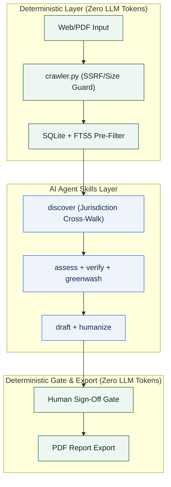

# VeriGreen-ops

Local-first CLI agent and deterministic SQLite pipeline for CSRD (Revised ESRS 2026) and Voluntary SME Standard (VS) readiness auditing.

[](https://www.python.org/downloads/)
[](https://www.sqlite.org/fts5.html)
[](https://github.com/William-php-16/VeriGreen-ops)
[](Dockerfile)
[](.github/workflows/ci.yml)
[](.github/workflows/ci.yml)

`VeriGreen-ops` pairs deterministic Python scripts (`pymupdf`, `pandas`, `fpdf2`, `rich`, `httpx`) and local SQLite (`data/audit_pipeline.db`) with modular Agent Skills (`skills/`) for Antigravity (`agy`), Claude Code, Gemini CLI, and Codex CLI.


*Terminal readiness dashboard rendered by `python src/dashboard.py`, showing pipeline counts, human approval progress, requirement scores, and EU Green Claims alerts.*

---

## Architecture

The pipeline separates deterministic data acquisition, indexing, and export gates from AI skill execution so documents stay local and LLM calls operate only on pre-filtered snippets.



---

## Why VeriGreen-ops

| Audit Stage | Dump Full PDF Into LLM | VeriGreen-ops |
| :--- | :--- | :--- |
| Document Retrieval | Sends every page of every PDF into prompt context | Queries SQLite `pages_fts` (`src/db.py search-pages --limit 5`) for top-ranked pages only |
| Greenwashing Screen | Runs LLM inference across full reports | Runs regex pre-filtering (`src/db.py find-claims`) first; skips LLM screening when zero trigger terms match |
| Quantitative Math | Relies on LLM mental math over prose and tables | Aggregates CSVs with `pandas` in `src/ingestor.py` and enforces a 1% relative tolerance check in `/verigreen verify` |
| Provenance & Sign-Off | Outputs unverified summaries with no export lock | Requires exact page citations, `[DATA GAP]` tags, and `human_approved = 1` before `src/report_builder.py` exports |

---

## Supported Regulatory Rulebooks

| Rulebook File | Framework | Target Scope | CLI Seed Command |
| :--- | :--- | :--- | :--- |
| `config/esrs_standards.yaml` | `ESRS_2026`, `VS` | Revised ESRS 2026 (`E1`, `E4`, `E5`, `S2`, `G1`) and Voluntary SME (`VS-B3`) (9 requirements) | `python src/db.py init` |
| `config/examples/csddd_value_chain_due_diligence.yaml` | `CSDDD_2024` | EU Corporate Sustainability Due Diligence Directive (Art. 5, 7, 8, 10, 11, 12, 14, 15, 16, 22) | `python src/db.py seed --yaml config/examples/csddd_value_chain_due_diligence.yaml` |
| `config/examples/ghg_scope3_agrifood.yaml` | `GHG_FLAG_AGRIFOOD` | GHG Protocol Scope 3 Cat. 1, Land Sector & FLAG, and SBTi FLAG targets | `python src/db.py seed --yaml config/examples/ghg_scope3_agrifood.yaml` |
| `config/examples/rspo_ispo_palm_sustainability.yaml` | `PALM_RSPO_ISPO` | RSPO P&C, ISPO, NDPE, FPIC, peatland, and mill-to-plantation traceability | `python src/db.py seed --yaml config/examples/rspo_ispo_palm_sustainability.yaml` |
| `config/examples/sfdr_impact_finance_pai.yaml` | `EU_SFDR_PAI` | EU SFDR RTS Principal Adverse Impact indicators (`PAI 1` through `PAI 11`) | `python src/db.py seed --yaml config/examples/sfdr_impact_finance_pai.yaml` |
| `config/examples/vsme_value_chain_shield.yaml` | `VS` | EU Omnibus I Voluntary SME Standard (`VSME`) and value-chain protection cap | `python src/db.py seed --yaml config/examples/vsme_value_chain_shield.yaml` |
| `config/examples/acm_dutch_green_claims.yaml` | `NL_ACM_CLAIMS` | Netherlands ACM Guidelines on Sustainability Claims (ACM 5 Rules of Thumb) | `python src/db.py seed --yaml config/examples/acm_dutch_green_claims.yaml` |

Two supporting YAML files live in `config/` outside the requirement rulebooks:
- `config/jurisdiction_matrix.yaml`: Maps `(country_region, employee_count, sector)` to mandatory rulebooks and crosswalk blind spots (`GRI`, `ISO 14001`, `TCFD`, `RSPO`, `SBTi`) for `/verigreen discover`.
- `config/portals.yaml`: Lists target sustainability portal URLs for `python src/crawler.py --batch`.

---

## Quickstart

### Path A: Local Setup with Antigravity (`agy`) / CLI

Clone the repository, create `.venv`, install Python dependencies, and initialize SQLite:

**macOS / Linux (Bash):**

```bash
git clone https://github.com/William-php-16/VeriGreen-ops.git
cd VeriGreen-ops
python3 -m venv .venv
.venv/bin/python -m pip install --upgrade pip
.venv/bin/python -m pip install -r requirements.txt
.venv/bin/python src/db.py init
```

**Windows (PowerShell):**

```powershell
git clone https://github.com/William-php-16/VeriGreen-ops.git
cd VeriGreen-ops
python -m venv .venv
.\.venv\Scripts\python.exe -m pip install --upgrade pip
.\.venv\Scripts\python.exe -m pip install -r requirements.txt
.\.venv\Scripts\python.exe src\db.py init
```

*(Optional: run `bash scripts/setup_unix.sh` or `powershell -ExecutionPolicy Bypass -File scripts\setup_windows.ps1` to automate `.venv` creation and link `.claude/skills` and `.gemini/skills` to `skills/`.)*

Run the terminal dashboard directly or launch the agent pipeline:

```bash
# View pipeline status and readiness matrix
.venv/bin/python src/dashboard.py

# Or on Windows:
# .\.venv\Scripts\python.exe src\dashboard.py
```

Inside your CLI session (`agy`, `claude`, or `gemini`), run the end-to-end workflow against a public sustainability portal:

```text
/verigreen https://example.com/sustainability
```

To test locally without network access, generate and ingest the synthetic fixtures in `data/sample/`:

```bash
.venv/bin/python scripts/create_sample_data.py
.venv/bin/python src/ingestor.py --dir data/sample
.venv/bin/python src/dashboard.py
```

### Path B: One-Command Docker Run

The `Dockerfile` builds on `python:3.12-slim` as a non-root `verigreen` user and defaults to `python src/dashboard.py`. Mount `data/` and `output/` so SQLite state, downloaded reports, and rendered PDFs persist on the host:

```bash
docker build -t verigreen-ops .
docker run --rm -v "$(pwd)/data:/app/data" -v "$(pwd)/output:/app/output" verigreen-ops
```

Initialize the database or run another CLI command inside the same container image:

```bash
docker run --rm -v "$(pwd)/data:/app/data" -v "$(pwd)/output:/app/output" verigreen-ops python src/db.py init
```

---

## Security & Governance Highlights

- **SSRF, Redirect, Path-Traversal & 50 MB Download Guards (`src/crawler.py`):** `validate_url()` permits only `http`/`https` URLs and rejects private, loopback, link-local, multicast, reserved, and unspecified IP addresses on initial requests and across up to 5 redirect hops (`_get_validated()`). `sanitize_filename()` and `_assert_within_dir()` block path traversal, and `download_file()` aborts streams larger than 50 MB (`MAX_BYTES = 50 * 1024 * 1024`) or `text/html` error pages.
- **Indirect Prompt Injection Delimiters (`src/db.py`, `skills/00_system_guardrails.md`):** `get-pages`, `search-pages`, and `find-claims` wrap extracted document text inside `<untrusted_document_content>...</untrusted_document_content>` tags so agents treat external text strictly as passive data.
- **Safe Parsing & Parameterized SQL (`src/db.py`, `src/crawler.py`):** Configuration files load via `yaml.safe_load()`, and all SQLite reads and writes use parameterized `?` queries with `PRAGMA foreign_keys = ON` and WAL mode.
- **Human-in-the-Loop (HITL) Export Gate (`src/db.py`, `src/report_builder.py`):** `save-draft` always resets `human_approved = 0`. `src/report_builder.py` exits with code `1` whenever any draft remains unapproved unless `--approved-only` is passed.
- **Automated CI Checks (`.github/workflows/ci.yml`):** Pushes and pull requests to `main` run `python -m pytest -v`, `bandit -r src/ -ll`, and `pip-audit -r requirements.txt` on Python 3.12.

---

## Deep Dives

<details>
<summary>Repository Layout</summary>

```text
VeriGreen-ops/
|-- .agents/
|   |-- rules/graphify.md
|   `-- workflows/
|       |-- graphify.md
|       `-- verigreen.md
|-- .github/workflows/ci.yml
|-- config/
|   |-- examples/
|   |   |-- acm_dutch_green_claims.yaml
|   |   |-- csddd_value_chain_due_diligence.yaml
|   |   |-- ghg_scope3_agrifood.yaml
|   |   |-- rspo_ispo_palm_sustainability.yaml
|   |   |-- sfdr_impact_finance_pai.yaml
|   |   `-- vsme_value_chain_shield.yaml
|   |-- company_context.md
|   |-- esrs_standards.yaml
|   |-- jurisdiction_matrix.yaml
|   `-- portals.yaml
|-- data/
|   |-- raw_docs/
|   `-- sample/
|       |-- sample_emissions.csv
|       `-- sample_sustainability_report.pdf
|-- output/
|-- scripts/
|   |-- create_sample_data.py
|   |-- setup_unix.sh
|   `-- setup_windows.ps1
|-- skills/
|   |-- 00_system_guardrails.md
|   |-- ADDING_A_SKILL.md
|   |-- approve/SKILL.md
|   |-- assess/SKILL.md
|   |-- crawl/SKILL.md
|   |-- discover/SKILL.md
|   |-- draft/SKILL.md
|   |-- export/SKILL.md
|   |-- greenwash/SKILL.md
|   |-- humanize/SKILL.md
|   |-- ingest/SKILL.md
|   |-- status/SKILL.md
|   |-- verify/SKILL.md
|   `-- verigreen/SKILL.md
|-- src/
|   |-- crawler.py
|   |-- dashboard.py
|   |-- db.py
|   |-- ingestor.py
|   `-- report_builder.py
|-- tests/
|   `-- test_core.py
|-- AGENTS.md
|-- CLAUDE.md
|-- DATA_CONTRACT.md
|-- Dockerfile
|-- GEMINI.md
|-- README.md
`-- requirements.txt
```

</details>

<details>
<summary>Extended CLI Command Reference</summary>

All scripts accept `--db <path>` (default: `data/audit_pipeline.db`).

### `src/db.py`

| Subcommand | Options | Purpose |
| :--- | :--- | :--- |
| `init` | `[--reset] [--yaml config/esrs_standards.yaml]` | Create SQLite tables, `pages_fts` FTS5 index, and seed a rulebook |
| `seed` | `--yaml <path>` | Upsert an additional YAML rulebook without wiping existing assessments |
| `status` | None | Print JSON table row counts |
| `list-unassessed` | `[--framework <name>]` | List unassessed `(req_id, doc_id)` pairs |
| `get-pages` | `--doc-id <id>` | Return extracted pages wrapped in `<untrusted_document_content>` |
| `search-pages` | `--req-id <id> [--limit 5]` | Query `pages_fts` BM25 index for top matching pages |
| `find-claims` | None | Scan `document_pages` with regex for greenwashing trigger terms |
| `save-assessment` | `--json <json>` | Upsert an assessment record (`readiness_score` between `1.0` and `5.0`) |
| `save-draft` | `--req-id <id> --file <path>` | Upsert a Markdown draft and reset `human_approved = 0` |
| `approve` | `--req-id <id> [--notes "..."]` | Mark a disclosure draft as human-approved (`human_approved = 1`) |
| `save-profile` | `--json <json>` | Upsert a discovered company profile into `company_profiles` |
| `show-profile` | `[--company-id <id>]` | Print saved company profile records as JSON |

### `src/crawler.py`

```bash
# Single webpage or direct PDF/CSV URL (ingests visible web text + discovered ESG files)
python src/crawler.py --url "https://example.com/sustainability" [--dir data/raw_docs] [--all-files] [--timeout 30.0] [--max-files 25]

# Batch crawl all enabled portals in config/portals.yaml
python src/crawler.py --batch [--portals config/portals.yaml] [--dir data/raw_docs] [--all-files] [--timeout 30.0] [--max-files 25]
```

### `src/ingestor.py`, `src/dashboard.py`, `src/report_builder.py`, and `scripts/create_sample_data.py`

```bash
# Recursively ingest local PDF and CSV files with SHA-256 deduplication
python src/ingestor.py [--dir data/raw_docs]

# Render the Rich terminal readiness dashboard
python src/dashboard.py

# Render the 3-section A4 PDF Assurance Pack (blocks with exit 1 if any draft has human_approved = 0)
python src/report_builder.py [--output output/verigreen_assurance_pack.pdf] [--approved-only]

# Generate synthetic test fixtures in data/sample/
python scripts/create_sample_data.py
```

### Agent Workflow & Unified `/verigreen` Commands

Configured in [`.agent/workflows/verigreen.md`](.agent/workflows/verigreen.md), [`.agents/workflows/verigreen.md`](.agents/workflows/verigreen.md), and [`skills/verigreen/SKILL.md`](skills/verigreen/SKILL.md) (with internal modules in `skills/`):

| Command | Action |
| :--- | :--- |
| `/verigreen` or `/verigreen status` | Run `src/dashboard.py` and print the current audit table and next recommended step. |
| `/verigreen <url>` | Run the full end-to-end audit pipeline (`crawl` -> `discover` -> `assess` -> `verify` -> `greenwash` -> `draft` + `humanize` -> `dashboard`), pausing only at Human Gate 1 (unknown jurisdiction) and Human Gate 2 (draft approval before export). |
| `/verigreen crawl <url>` or `/verigreen crawl --batch` | Load `skills/crawl/SKILL.md` and run `src/crawler.py` (never fall back to `curl.exe`). |
| `/verigreen ingest` | Run `src/ingestor.py` to parse local PDFs/CSVs in `data/raw_docs/` into SQLite and index `pages_fts`. |
| `/verigreen discover` | Load `skills/discover/SKILL.md` to extract company profile, consolidation approach, and boundary exclusions, merge via `src/db.py save-profile`, and auto-seed matched YAML rulebooks. |
| `/verigreen assess` | Load `skills/assess/SKILL.md` to score unassessed requirements via `src/db.py search-pages` (FTS5) with boundary caps enforced. |
| `/verigreen verify` | Load `skills/verify/SKILL.md` to run deterministic CSV and YoY math checks. |
| `/verigreen greenwash` | Load `skills/greenwash/SKILL.md` to run `src/db.py find-claims` and evaluate flagged marketing statements. |
| `/verigreen draft` | Load `skills/draft/SKILL.md` and apply `skills/humanize/SKILL.md` as the final pass before saving to `disclosure_drafts` (`human_approved = 0`). |
| `/verigreen draft-rulebook <jurisdiction_or_law>` | Load `skills/draft_rulebook/SKILL.md` to generate, validate, and review a new YAML rulebook in `config/examples/`. |
| `/verigreen humanize <req_id\|all>` | Load `skills/humanize/SKILL.md` to rewrite existing draft prose without altering numbers, units, quotes, citations, or `[DATA GAP]` tags. |
| `/verigreen approve <req_id\|all>` | Run `src/db.py approve` to unlock human-verified drafts. |
| `/verigreen export` | Run `src/report_builder.py` to generate the A4 PDF Assurance Pack (only for `human_approved = 1` drafts). |

</details>

---

## Contributing

Add custom audit checks or regulatory rulebooks without editing `src/`:
1. Append custom requirements to `config/esrs_standards.yaml` (or add a new YAML file under `config/examples/`) and seed it with `python src/db.py seed --yaml <path>`.
2. Follow [`skills/ADDING_A_SKILL.md`](skills/ADDING_A_SKILL.md) to author a new `skills/<skill-name>/SKILL.md` slash command.
3. Run the test suite before opening a pull request:

```bash
.venv/bin/python -m pytest -v
```
